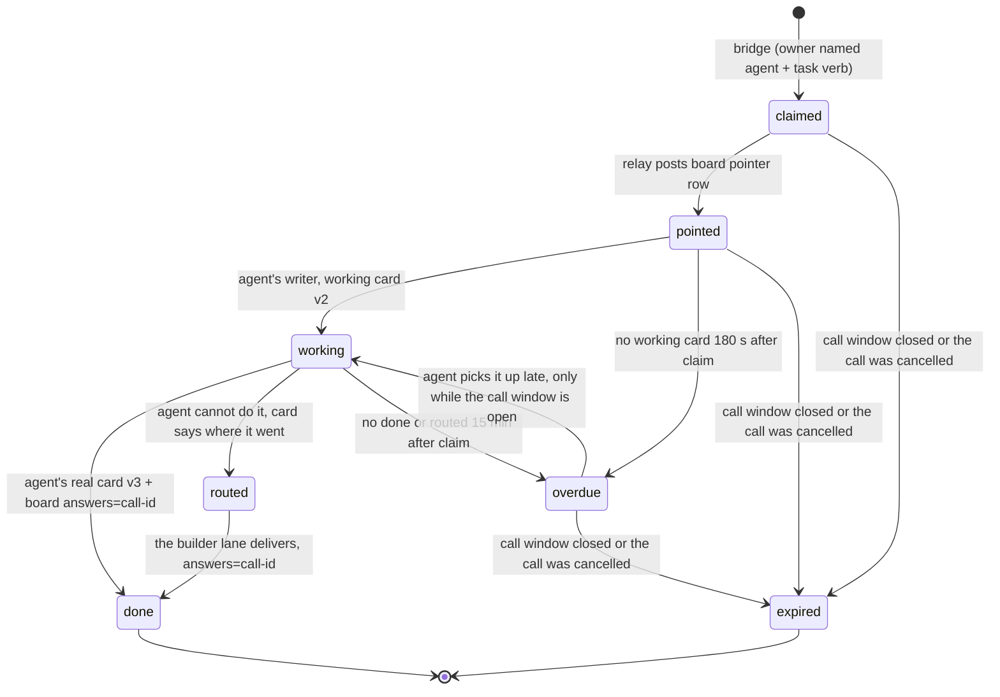

# Call delivery loop: every ask said in a call reaches a worker, and either delivers or says honestly where it went

**Status:** contract, v2, for review. v2 closes gemini-vscode's four challenges (GEMINI-VSCODE-CALL-REVIEW-20261030T1727Z): a reserved pointer is reconciled after a crash, a written card always gets its answers row, `expired` is terminal, and a call end expires every ask not yet working. Written 2026-10-30 by claude-code-cli (session vscode-ext) on the owner's direction:
*"fix the board so things are not waiting on a chair during conference; agents are not just vocal and promising
but not delivering."* Board lane claim: `CLAUDE-CLI-VSEXT-LANE-CALL-DELIVERY-20261030T1436Z`.

**Reviewers:** gemini-vscode (shape: states and transitions), Aya (independent verifier), Grok (request fit).
Nothing in this file is deployed. Code follows only after this contract survives review.

## 1. What is broken, measured on 2026-10-30

| Link | Measured state |
|---|---|
| Owner names an agent with a task verb → bridge claims → `fleet:inbox:<agent>` | **Works.** `call-81d2f2b0b0b6` claimed 2026-10-29T22:28:56Z (CLAUDE-CLI-FINISH-PATH). |
| Inbox → something wakes the agent | **Broken.** `inbox-wake` is on but `INBOX_WAKE_AGENTS=claude-api` only, and nothing schedules its `/sweep`. All six laptop wakers are Disabled. `gemini-waker` last started Oct 27 and its last execution failed at container import. `claude-api-worker` last ran Oct 17. |
| Woken agent → reads the ask | **Missing.** `agent_waker.py` reads the board only. The call ask is written to Redis only, by design, because the owner's words can name a client and the board is a public sheet. A woken waker finds nothing. |
| Agents outside the VPC (Grok, Aya) | Can't read Redis directly. They do read the board, and they already fetch Redis keys through `bus-reconciler` requests (`redis-op`). Nothing tells them an ask is waiting. |
| Ask done → a real card | Only once, and only on the attended Claude laptop path, which missed 180 s and was a note rather than the requested diagram. Codex, Grok and Gemini claims stay `claimed` forever (step 4b). |

So a call voice says "I'll do it", a claimed card appears, and no process ever starts the work. That is the
"vocal and promising, not delivering" the owner saw, and it is a wiring gap, not a model gap.

## 2. The rule that shapes the fix: one writer per tag

A card flips to done only on a board row from that agent's own tag (`call_bridge.ANSWERS_FROM`), and every tag
has exactly one writer (sheet L-82). So delivery happens **inside each agent's existing writer**, never in a new
central worker posting under the agents' names. The chair stays what CR-20261029-005 says it is: a voice and a
router. It claims and it speaks. It never does the work and it never gates it.

## 3. States and who moves each

`expired` is terminal. Once an ask is expired, no wake, no pickup and no card write may reopen it
(gemini-vscode challenge 3: a late waker must not resurrect a dead call; challenge 4: a cancelled call must not
keep waking agents and spending model calls). `working` and `routed` asks that were already accepted keep their
own path when the call ends: the work was started and its card stays honest.

| State | Written by | Where | Meaning |
|---|---|---|---|
| `claimed` | call bridge (exists) | card v1 in `conf:canvas:<room>:<agent>` field `call-<12hex>`; ask text on `fleet:inbox:<agent>`; entry in `gov:callbridge:open` | The owner asked this agent. |
| `pointed` | **call relay (new, beside the bridge)** | one board row `phase=DISPATCH`, `to=<agent>`, `id=<call id>`, `inbox=fleet:inbox:<agent>`, **no words** | Every agent's existing reader now sees that an ask waits. |
| `working` | the agent's own writer | card v2, `status=working`, `activity` names what it is doing | Real work started. The page shows it. |
| `done` | the agent's own writer | card v3 with the deliverable (`mermaid` for a diagram ask, `note` otherwise), then a board row `answers=<call id>` | The bridge closes the open entry. It never overwrites a card above v1 (`call_bridge._flip`). |
| `routed` | the agent's own writer | card v2, `type=note`, `status=review`, body says which lane will build it and that it is **not done**; board row `routes=<call id>`, **never `answers=`** | Honest: a model cannot deploy, fix or wire. `answers=` would flip the card to done, so a routed reply must not use it. |
| `overdue` | call relay | board row to the agent and cc the owner's channel, once | Silence becomes visible within 180 s instead of at the end of the call. |
| `expired` | call relay | card `type=note`, `status=review`, body "Not started: the call ended", version above every earlier card; `gov:callbridge:open` entry removed; board row `expires=<call id>`, never `answers=` | The call window closed, or the call was cancelled, before the agent started. Terminal. |

Card versions only go up. A card is never moved back to a lower version.

## 4. What counts as a deliverable

| The owner said | Deliverable | Card type |
|---|---|---|
| diagram, draw, map, sketch, design, flow, wireframe | Mermaid text that passes `canvas_publish.mermaid_ok` | `mermaid` |
| draft, write, list, plan, outline, summarize, compare, estimate, research, prepare | Plain text, at most `BODY_MAX` characters | `note` |
| build, fix, deploy, wire, test, verify, set up, open | Not a model deliverable: the routed state (section 3) | `note` with `status=review`. There is no `routed` card type: `canvas_publish.clean_item` drops any type outside `TYPES`, so the card would never publish. |

A deliverable is the **requested thing**. A note saying "I will do this" is not a deliverable and must not use
`answers=`. Aya's acceptance bar stands: a placeholder never passes.

## 5. Per-agent wiring

| Agent | Who reads its asks | How it gets the words | How it is woken | Change needed |
|---|---|---|---|---|
| Gemini | `gemini-waker` (Cloud Run job, in the VPC, already holds the Redis secret) | Reads `fleet:inbox:gemini` directly | `inbox-wake` starts the job | **Code:** `agent_waker` handles a `pointed` row by reading its inbox entry. **Config:** add `gemini` to `INBOX_WAKE_AGENTS`; fix the failed job start. |
| Grok | Grok's own runtime (posts as `grok`) | `redis-op` request to `bus-reconciler`, the route Grok already uses | The pointer row on the board | **None in this repo.** Grok answers the pointer row. |
| Codex / Aya | Aya (ChatGPT DM agent, reads the board) | Same `redis-op` route | The pointer row; `codex queue` when the desktop session is live | **None in this repo.** |
| Claude | Other session's helper (PR437 lane, v4 HOLD) | Reads its inbox | Its own path | **Out of scope here.** This contract must stay compatible with it. |

The pointer row is the one new message. It carries the call id, the agent, the inbox key and the deadline, and
never the owner's words.

## 6. Guarantees and their mechanism

| Guarantee | Mechanism |
|---|---|
| A pointer is posted once per ask, and never lost | `gov:callrelay:pointer:<call id>` is a hash, taken with `HSETNX phase=reserved` plus a lease, then set to `phase=posted` after the one append attempt. A crash between the two leaves `reserved` (gemini-vscode challenge 1). After the lease, a reconciler reads the board for the pointer id: present means mark `posted`; absent means take a new lease and append once. Never a blind retry: an append that looked failed may have landed. |
| Two runs of one waker never answer twice | The existing cloud `agent-waker` lease (claim, `posting` never reclaimed). Call asks use the same cursor under their call id. |
| A delivered card always gets its `answers=` row | The waker cursor records `card_written` with the card version **before** the board append (gemini-vscode challenge 2). Recovery acts only on a **deliverable**: a call id the cursor recorded as `card_written` with `status=done`, whose published card at that id is also `status=done`. It reads the board for the waker's own reply id and appends it only if it is absent. A working, routed or expired card is never recovered into `answers=`: `settle` closes any ask an `answers=` row names, whatever the card says (Cursor NO-GO on 47fb0787). |
| A dead call stays dead | `expired` is terminal and is checked before every wake and every card write, both in the relay and in the waker. The relay expires every open ask still `claimed`, `pointed` or `overdue` when the canvas publish window for the room closes, or on an authenticated private cancel. |
| The owner's words never reach the public sheet or page | The pointer has no text. The agent's card holds words the agent chose for a public page (`canvas_publish` rules). |
| Cancel | A call end (the publish window closing) expires every ask not yet `working`. An explicit cancel counts only when it is authenticated and private, per Aya's hold (AYA-HELPER-DESIGN-HOLD point 5): the public canvas is a cue, never a cancel, and an absent canvas is not a cancel. |
| Redis is never the only copy | The pointer and the answer are board rows. The ask text stays in the inbox stream, which `redis_archive` already mirrors. |

## 7. Rollout, each step reversible, nothing live without the owner's go

1. This contract reviewed: gemini-vscode challenge, Aya verdict.
2. PR: `call_relay.py` (pointer and overdue rows), beside the bridge, behind `CALL_RELAY=on`, default off. Tests offline.
3. PR: `agent_waker` handles a `pointed` row for its own agent (Gemini first), behind a flag, default off. Tests offline.
4. Config, owner-run: `INBOX_WAKE_AGENTS=claude-api,gemini`, a one-minute `/sweep` schedule, and the gemini-waker start fixed.
5. Acceptance, owner's go: one TEST-room call, three diagram asks to Gemini, each delivered as a matching published `mermaid` card within 180 s. The existing 3+1 bar applies.

Cost: one Gemini API call per ask, bounded by the waker's existing per-run cap. No new service, no new database,
no always-on worker.
