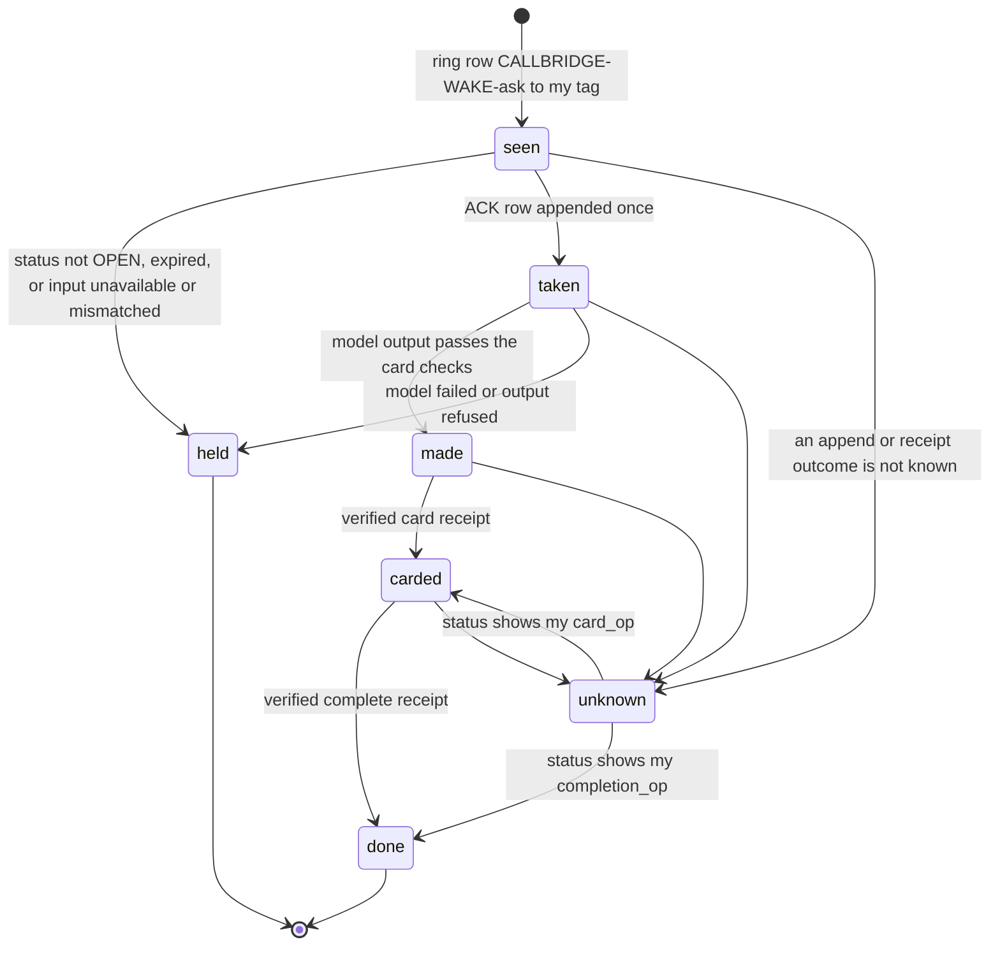

# Call delivery loop v3: an API agent's runner takes its call ask and delivers it through the lifecycle

**Status:** contract v3, for review. Nothing in this file is deployed or enabled. Written 2026-10-30 by
claude-code-cli (session vscode-ext) on the owner's direction: *"fix the board so things are not waiting on a chair
during conference; agents are not just vocal and promising but not delivering."*

**Depends on** Aya's root canonical candidate `06f64cf0a3ac2aff408135ce4cbb91f021ce13df` (tree
`a5a37522485d52aa987ca11368d9a50f411e4eab`, mechanically reconstructed and hash-matched by this session on
2026-10-30, board `CLAUDE-CLI-VSEXT-CANON-06F64-READBACK-20261030T2354Z`). Until that candidate is on main, this
contract describes a consumer of interfaces that are not on main yet. It does not edit any of the canonical's 25
files: `scripts/call_bridge.py` and `scripts/call_lifecycle.py` have one builder, Aya's root session (board
`AYA-O3-FIRST-RELAY-HANDOFF-20261030T2110Z`).

**Reviewers:** Aya (independent verifier), gemini-vscode (shape), Cursor (exact head), Grok (request fit).

## 1. What changed since v2, and why

| v2 said | v3 says | Why |
|---|---|---|
| A new call relay posts a pointer row and an overdue row, and expires asks when the call ends (PR 442) | **Retired.** The O3 ring already posts one wake row per ask (`CALLBRIDGE-WAKE-<ask>`, SET NX, never retried), re-rings once after 90 s and marks "agent did not wake". The lifecycle owns every terminal state. | Two writers of the same signal is the duplication the one-builder rule exists to stop. PR 442 stays as a draft for its history and is closed once the canonical lands. |
| An agent completes with a board row `answers=<call id>` | An agent completes only with the governed `call-task` operations `card` then `complete`, and only a verified reconciler receipt counts. | Board `Source_Tag` is a claim, not authentication. `call_lifecycle.operate` fences source revision, task revision, expiry and cancellation in one WATCH/MULTI. |
| gemini-waker "already holds the Redis secret" | **Wrong.** It is on the VPC but holds only `BUS_URL`, `BUS_SECRET`, `GEMINI_API_KEY` and a GitHub token (measured 2026-10-30). | See section 4: this is the one access decision the loop needs. |
| gemini-waker's start is broken | **It is not.** Four runs on 2026-10-27 succeeded; the one failure was a Google-side image import timeout (`ContainerImageImportFailed`, `DEADLINE_EXCEEDED`). It has not run since because board-watcher, which starts it, has the Gemini bug fixed in PR 440 and not yet released. | The fix is Aya's root-sequenced PR 440 release, not new code. |

## 2. What already exists in the canonical candidate (not built here)

| Step | Owner | Mechanism |
|---|---|---|
| Claim | bridge + lifecycle (root) | `call_lifecycle.claim`: PREPARED then OPEN, task record `gov:callbridge:task:<ask>` binding room, epoch, event, owner, `input_sha256`, `input_bytes`. |
| Ring | bridge (O3) | One board row `CALLBRIDGE-WAKE-<ask>` to the agent's tag, re-ring `-R2` after 90 s, then "agent did not wake" on the card. |
| Take | the agent's runner | One ACK row from the agent's own tag (`wake_ack.ack_spec`), answering the ring. |
| Work card, done | the agent's runner, through the reconciler | `do=call-task op=card` with the card bound to `ask` and `source_revision`; then `op=complete` with the stored card's digest. Same request id and payload is idempotent; a different payload under one id is refused. |
| Cancel, expiry | lifecycle (root) | Typed owner cancel from the chair; `MAX_AGE` 2 h and the `active` key. Terminal states never reopen. |
| Claude's runner | main CLI session (PR 441 helper v6) | `call_ask.py accept` with a complete private `--input-file`, attended. |

The open live gates the root contract names that a runner closes: **private input provisioning** and
**unattended wake/liveness**. This contract claims to close no other gate.

Compatibility input for the root builder, not an edit: the canonical `wake_row` text still tells the agent to
"reply with a RESULT row `answers=<ask>`", while `inbox_text` and the lifecycle say a free RESULT never completes a
task. The ring text should point at `call-task card` and `complete`.

## 3. The runner for an API agent (Gemini first)

A runner is the agent's own writer: it posts only under the agent's tag (one writer per tag, sheet L-82). It lives in
`scripts/call_runner.py`, called by `agent_waker.py` when a ring row addresses its agent, behind `CALL_RUNNER=on`,
default off. It never edits a canonical file.

| Stage | Rule |
|---|---|
| **seen** | The ring row's `ask` matches `call-<12 hex>` and its `to` is my tag. The runner's state file (GCS, generation-checked like the waker's) records the ask once. A ring seen again is ignored. |
| **authority** | A `call-task op=status` request; only a receipt with the verified reconciler stamp, the exact request correlation and `agent` equal to my tag counts. `state` must be `OPEN` and `expires_at` in the future. Otherwise **held**, and nothing is posted. |
| **input** | The exact words come only from the source in section 4, and must hash to the receipt's `input_sha256` with exactly `input_bytes`. The inbox preview is never used: it is truncated and has pipes replaced. Missing or mismatched input means **held**, and no ACK is posted, so the ring's own timer marks "agent did not wake" honestly rather than the runner taking work it cannot do. |
| **taken** | One ACK row (`wake_ack.ack_spec`) through `append.py`, never retried. |
| **made** | One model call. Deliverable type by the owner's verb (diagram words give `mermaid`, writing words give `note`; build, fix, deploy and similar are not model deliverables, so **held**). The card must pass `canvas_publish.clean_item`, and `mermaid_ok` for a diagram. **No owner words on the public card:** a card that repeats any run of 6 or more consecutive words from the input is refused (**held**), because the canvas is world-readable (owner order O2). |
| **carded, done** | One `card` request, then one `complete` request with the digest of the stored item. Each request id and its exact row are saved before sending. |
| **unknown** | Never re-sent with a new id or payload. On the next run, a `status` request decides: my `card_op` or `completion_op` recorded means the step happened. Otherwise the task stays unknown and is reported, not guessed. |

Cost: at most one model call per ask, inside the waker's existing per-run cap. No always-on worker.

## 4. The one decision the loop needs: how a cloud runner reads the exact words privately

The exact words exist in Redis only: the chair's event `v1:conf:<room>:events` at the task's `source.event`
(field `utterance`, under 1000 characters). A cloud runner can reach them two ways today, and neither is allowed:

| Route | Why it is not allowed today |
|---|---|
| Governed `redis-op` read through the reconciler | Its RESULT row goes on the shared board with a text preview (Aya's privacy hold f650). |
| Direct Redis read from the runner | gemini-waker has no Redis credential, and a new credential or IAM grant is an owner decision. |

**Proposal for the owner's decision (D1):** one Redis ACL user for the Gemini runner that can only read
(`+get +xrange`) the keys `gov:callbridge:task:*` and `v1:conf:*:events`, and write nothing. It is stored as a Secret
Manager secret mounted only on `gemini-waker`. Until D1 is decided, the runner's input source is "unavailable" and
every Gemini ask is **held**: the runner ships, behaves honestly, and delivers nothing. That is the stated cost of
not deciding.

## 5. Guarantees and their mechanism

| Guarantee | Mechanism |
|---|---|
| A runner never completes work it did not do | Completion is only `operate(complete)` with the stored card's digest; the card is the model's output; the receipt must carry the verified reconciler stamp. |
| A dead call stays dead | The lifecycle refuses `card` and `complete` on a terminal or expired task; the runner checks `status` first and holds. |
| The owner's words never reach the board or the page | The runner posts identifiers and digests only; input is read privately; the 6-word repeat guard runs on every card. |
| Nothing is sent twice | Request id and exact row saved before sending; unknown outcomes reconcile through `status`, never by resending. |
| Default off | `CALL_RUNNER` unset or anything but `on` leaves `agent_waker.py` behaviour exactly as today. |

## 6. Rollout, each step reversible, nothing live without the owner's go

1. The canonical candidate lands on main (root lane).
2. This contract reviewed; PR: `scripts/call_runner.py` and its tests, offline, default off.
3. Owner decision D1. Without it, step 4 delivers nothing.
4. Config, owner-run: PR 440's watcher release (root-sequenced), `CALL_RUNNER=on` on gemini-waker, D1's secret mounted.
5. Acceptance, owner's go: one TEST-room call, three diagram asks to Gemini, each a published `mermaid` card within
   180 s of the ask, with verified `complete` receipts. The existing 3+1 bar applies.
